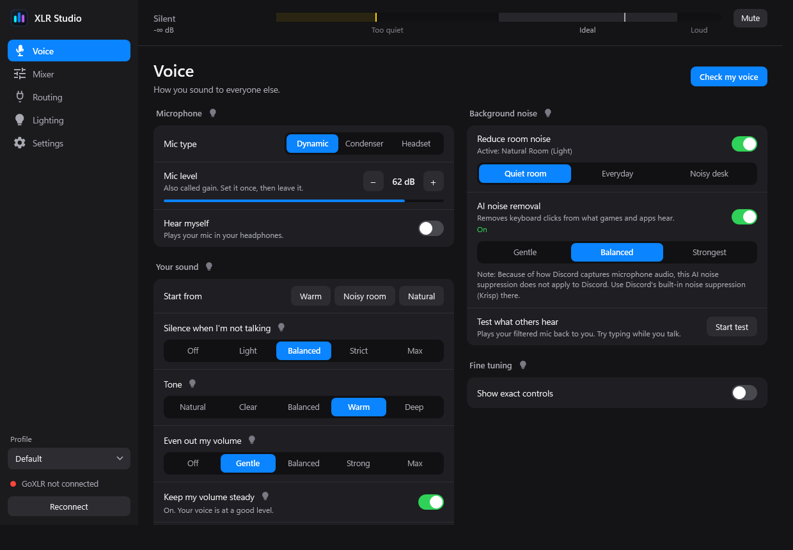
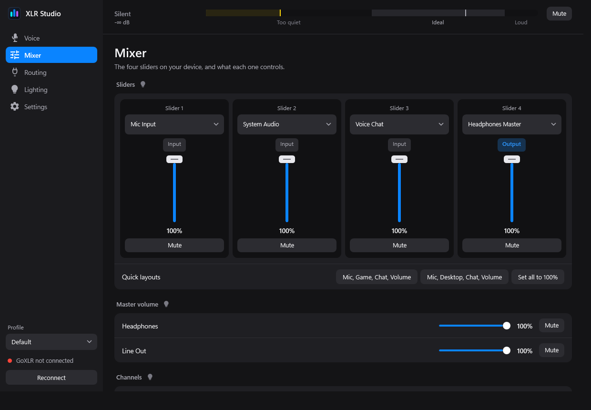
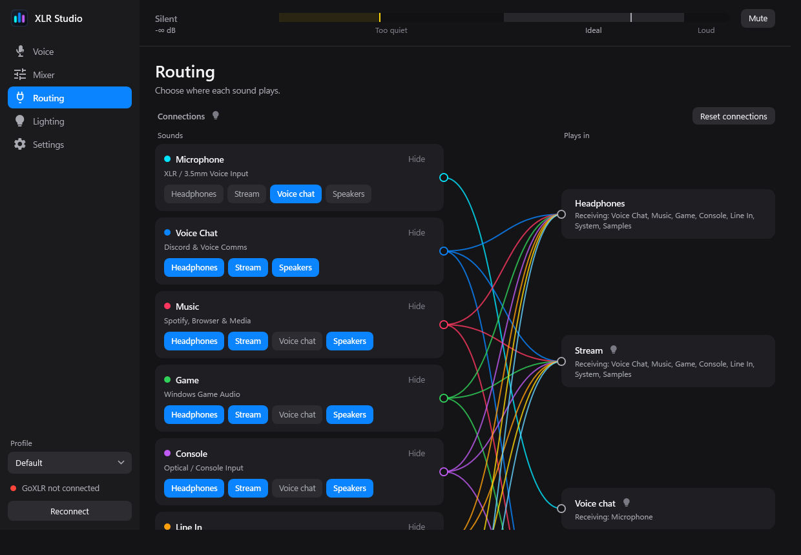
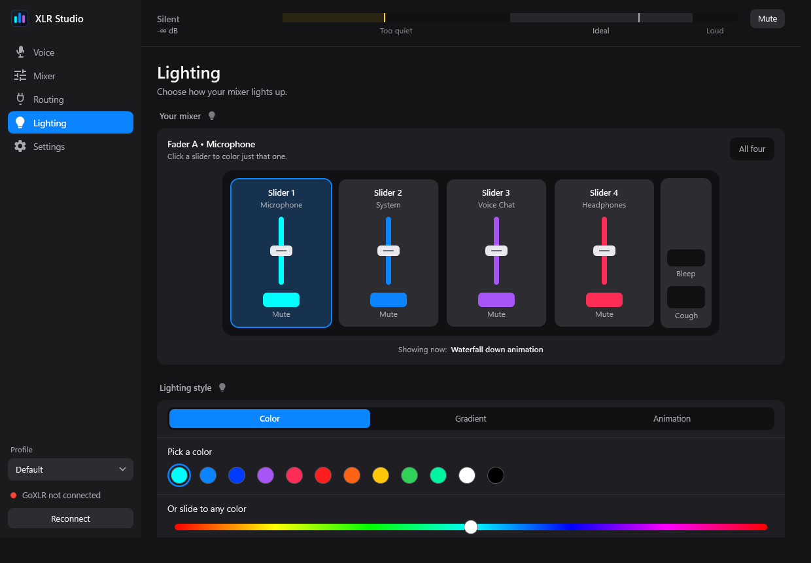
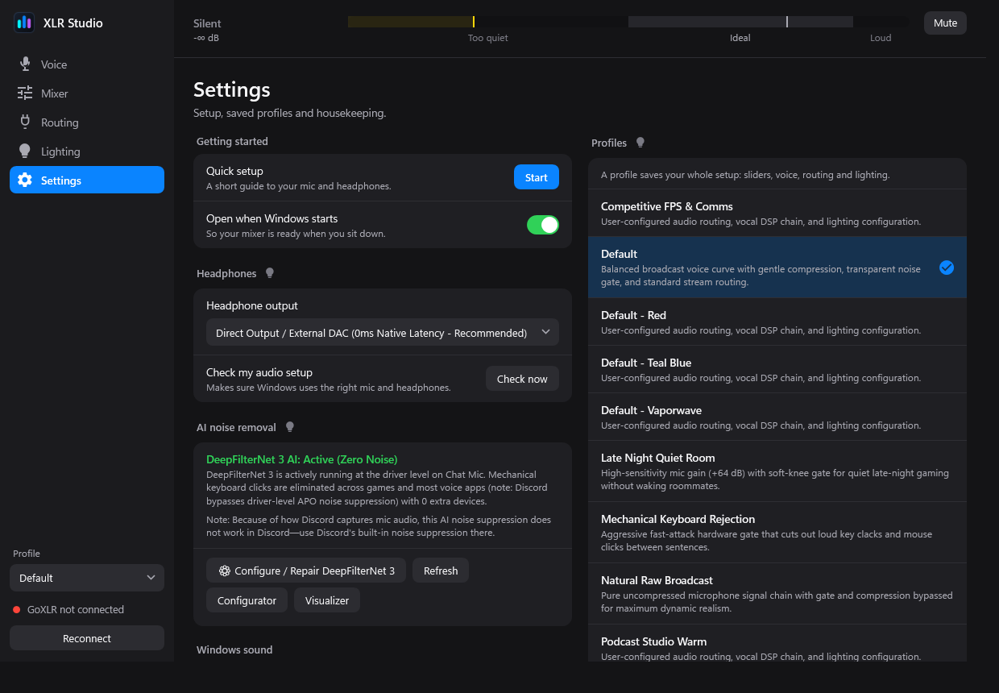

# Project XLR

A lightweight, open-source Windows control app for the **TC-Helicon GoXLR Mini**, built with .NET 9 and WPF.

TC-Helicon discontinued the official GoXLR App years ago, and the legacy software feels clunky and bloated. Project XLR skips it completely—talking straight to the official TC-Helicon / Thesycon USB audio driver (`goxlr_audioapi_x64.dll`) through a clean native UI, so you can close and uninstall the old GoXLR App while keeping full hardware control.

Built and tested primarily for the **GoXLR Mini** on Windows 10/11 (x64).

<table>
  <tr>
    <td></td>
    <td></td>
  </tr>
</table>

<details>
<summary>More screenshots (Routing, Lighting, Settings)</summary>

| Routing | Lighting | Settings |
|---|---|---|
|  |  |  |

</details>

## What's in it

* **Direct driver control:** Talks straight to `goxlr_audioapi_x64.dll` via P/Invoke—no background GoXLR App or extra virtual audio driver required.
* **Mixer:** Bidirectional 4-fader sync, channel assignments, mute / cough / bleep button handling, and a real-time mic meter.
* **Voice:** Hardware mic gain, EQ, noise gate, compressor/leveler, and de-esser—plus a guided **Check my voice** calibration (measures your room noise and voice level to dial in the gate and leveler) and a real-time **Voice Coach**.
* **Routing:** Visual patch-bay routing matrix across Headphones, Broadcast Mix, Chat Mic, Line Out, and Sampler, with feedback-loop protection and external USB DAC support.
* **Lighting:** Solid colors, per-fader colors, gradients, and animations synced live to the unit.
* **Housekeeping:** Save/switch profiles, minimize to the system tray, optional launch on Windows startup, and optional **DeepFilterNet 3** AI noise removal on `Chat Mic`.

## Install

1. **Keep the official GoXLR USB audio driver installed**—Windows needs it for the `System`, `Game`, `Chat`, and `Chat Mic` audio devices and `goxlr_audioapi_x64.dll`.
2. **Close (or uninstall) the old `GoXLR App.exe`**—only one app can hold the USB control handle at a time.
3. Download **`ProjectXLR-win-x64.zip`** from [Releases](../../releases), extract it, and double-click **`Install.bat`**.

`ProjectXLR-win-x64.zip` ships as a self-contained single-file executable (no .NET SDK needed). `Install.bat` drops it into `%LOCALAPPDATA%\Programs\Project XLR\`, sets up Start Menu and Desktop shortcuts, and optionally walks you through AI noise removal.

## Building from source

Requires the [.NET 9 SDK](https://dotnet.microsoft.com/download/dotnet/9.0) on Windows x64:

```powershell
git clone https://github.com/ereyes-jr/XLR-Studio.git
cd XLR-Studio

# Build Release and run
dotnet build src\ProjectXLR\ProjectXLR.csproj -c Release
.\Launch Project XLR.bat

# Or run directly in Debug
dotnet run --project src\ProjectXLR\ProjectXLR.csproj

# Run unit tests
dotnet test tests\ProjectXLR.Tests\ProjectXLR.Tests.csproj
```

Pushing a `v*` tag triggers [release.yml](.github/workflows/release.yml) to run tests, publish a self-contained single-file binary, and attach `ProjectXLR-win-x64.zip` to a new GitHub Release.

## Optional: DeepFilterNet 3 AI noise removal

Project XLR can hook **DeepFilterNet 3** directly onto `Chat Mic` using **Equalizer APO** and the **Alt-Denoiser** VST plugin—zero extra virtual audio cables or extra devices in games and apps. Those third-party binaries aren't committed to git due to size, so if you want it:

> **Note (Discord):** Because of how Discord handles microphone capture and audio processing, DeepFilterNet 3 / Equalizer APO noise suppression does not work in Discord. Keep Discord's built-in noise suppression (Krisp) enabled for Discord.

1. Grab **[Equalizer APO (x64)](https://sourceforge.net/projects/equalizerapo/)** and **[Alt-Denoiser (Windows)](https://github.com/Altinus/Alt-Denoiser/releases)**.
2. Either drop them into `tools\EqualizerAPO\` and `tools\Alt-Denoiser\Alt-Denoiser-windows\` and run [Setup-DeepFilterNet.bat](tools/Setup-DeepFilterNet.bat), or use the setup button on the **Settings** / **Voice** page in the app.

## Protocol notes & repo layout

If you're curious how the TC-Helicon / Thesycon driver commands map to faders, routing, DSP, and LEDs, check [re/PROTOCOL.md](re/PROTOCOL.md).

* `src/ProjectXLR/` — WPF app, ViewModels, NAudio monitoring, and `TUsbAudioInterop` / `GoXlrDeviceController`
* `tests/ProjectXLR.Tests/` — xUnit tests for `VoiceAssist` and `VoiceCheckAnalyzer`
* `re/` — Reverse-engineered USB/driver protocol specs and capture scripts
* `tools/` — Optional DeepFilterNet 3 + Equalizer APO setup script
* `Install.bat` / `Install.ps1` — End-user Windows installer

## FAQ & Troubleshooting

Have a question or hit an issue (device not detected, Discord/game audio routing, Equalizer APO hooks after a Windows update)? Check [FAQ.md](FAQ.md) first.

## License

MIT — see [LICENSE](LICENSE).

Not affiliated with or endorsed by TC-Helicon or Music Tribe.
